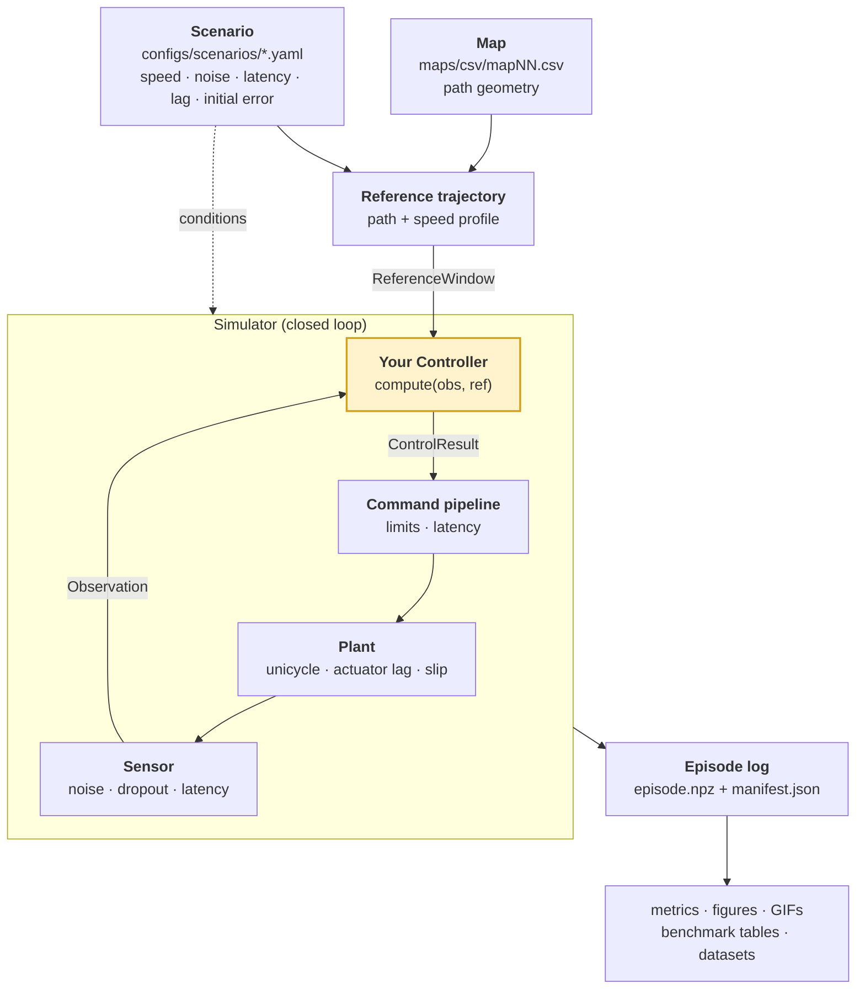

# Differential-Wheeled Robots

**One simulator, one controller interface, reproducible benchmarks for differential-drive trajectory tracking.**

This project lets you implement a tracking controller — PID, Pure Pursuit, LQR,
iLQR, MPC, a learned policy — by writing a single `compute(obs, ref)` method.
The framework provides everything else: reference paths, a deterministic
multi-rate simulator with noise, latency and actuator effects, logging, metrics,
figures, animations, benchmark suites and dataset export.



## Setup

```bash
python -m venv .venv && source .venv/bin/activate
pip install --group test   # or --group main if you only run scripts
pytest                     # ~20 s
```

Python ≥ 3.10, pip ≥ 25.1 (for `--group`). Scripts are run from the repository
root; the project itself is not installed. Dependency groups in `pyproject.toml`:
`main` (scripts), `test` (+ pytest), later `mpc` (OSQP, CasADi) and `learning`
(PyTorch, Gymnasium).

## Layout

```text
main.py            run one episode: map × scenario × controller
benchmark.py       run a suite: maps × scenarios × controllers × seeds
visualize.py       benchmark tables + figures, or compare saved episodes
export_dataset.py  saved episodes → (observation, expert command) dataset
diffdrive/         the library: core, models, references, controllers, sim, evaluation, viz
maps/              reference paths: yaml/, csv/, png/ previews, generate.py
configs/           scenarios/ (conditions) and suites/ (benchmark definitions)
examples/  tests/  docs/
runs/  datasets/   outputs (git-ignored)
```

## Quick start

```bash
python main.py --list                                         # controllers, maps, scenarios, suites
python main.py --map map02 --controller pid                   # print metrics only
python main.py --map map02 --controller pid --save            # + episode data, summary.png, GIF
python main.py --map map05 --scenario noisy --controller pure_pursuit --save
python main.py --scenario delayed --controller pid --set command.latency=0.1

python visualize.py runs/single/<run A> runs/single/<run B> --gif compare.gif

python benchmark.py --suite nominal --jobs 4 --report          # tables + figures
python visualize.py runs/<stamp>_nominal --metric cte_rmse     # re-draw / other metrics
```

`--map` picks the path, `--scenario` the conditions (default `nominal`).
`--param key=value` sets controller parameters; `--set key=value` overrides any
scenario field (`python main.py --scenario noisy --show` prints all of them).
Every script has `--help`.

## Maps and scenarios

A **map** is geometry only: `maps/map00` … `map07` are a line, circle,
figure-eight, S-curve and four random splines — see the
[map catalogue](maps/README.md). Make new ones with
`python maps/generate.py --random --points 6 --seed 9`.

A **scenario** is the experimental conditions, with a default map:

| Scenario | Conditions |
|---|---|
| `nominal` | exact pose, no latency, no lag |
| `lateral_offset`, `heading_offset` | start 0.5 m to the side / 90° off |
| `stop_and_go` | 1 s full stop half-way |
| `noisy`, `delayed`, `noisy_delayed` | pose noise, sensor + command latency, both |
| `actuator_lag` | first-order actuator lag and wheel slip |

Write your own as YAML, optionally inheriting from another:

```yaml
# configs/scenarios/hard.yaml
base: noisy_delayed
map: map06
overrides:
  sensor.latency: 0.08
  plant.tau_v: 0.15
```

**Suites** (`configs/suites/`) cross maps × scenarios × controllers × seeds and can
sweep any scenario field; every controller sees identical conditions and seeds.

## Write your own controller

```python
from dataclasses import dataclass
import math
from diffdrive.controllers import Controller, register
from diffdrive.core import Control, ControlResult, RefRequest
from diffdrive.core.geometry import body_frame_error

@register("kanayama")
class Kanayama(Controller):
    @dataclass(frozen=True)
    class Config:
        k_x: float = 1.0
        k_y: float = 6.0
        k_theta: float = 3.0

    def reference_request(self):
        return RefRequest(mode="time", horizon=0)   # or mode="path"; horizon=N for preview

    def compute(self, obs, ref):
        c = self.config
        e_x, e_y, e_th = body_frame_error(obs.pose.as_array(), ref.poses[0])
        v_r, w_r = ref.controls[0]
        v = v_r * math.cos(e_th) + c.k_x * e_x
        w = w_r + v_r * (c.k_y * e_y + c.k_theta * math.sin(e_th))
        return ControlResult(self.ctx.limits.saturate(Control(v, w)))
```

Run it straight from a file:

```bash
python main.py --map map02 --controller examples/my_controller.py:Kanayama --save
```

What a controller receives:

| | |
|---|---|
| `obs.pose`, `obs.t_sample` | pose **measurement** (noisy/biased/delayed per scenario) and when it was taken |
| `obs.last_command` | the last command you sent (after the safety limiter) |
| `ref.poses`, `ref.controls`, `ref.times`, `ref.s`, `ref.curvature` | reference window of `horizon + 1` samples, time- or arclength-indexed |
| `self.ctx.dt`, `self.ctx.limits`, `self.ctx.model`, `self.ctx.rng` | control period, command limits, nominal `Unicycle` model, private RNG |

Return predicted states (`ControlResult(..., predicted_states=X)`) and they are logged
and drawn in animations. See [docs/architecture.md](docs/architecture.md) for the full contract.

## Controllers

| Name | Type | Status |
|---|---|---|
| `feedforward` | open-loop `u_r` (sanity baseline) | ready |
| `pid` | body-frame PID, time or path mode, anti-windup | ready |
| `pure_pursuit` | arclength lookahead, adaptive `L_d` | ready |
| `lqr`, `ilqr`, `linear_mpc`, `nonlinear_mpc`, `lie_lqr`, `lie_mpc` | | templates with step-by-step TODOs and acceptance tests |

Progress is tracked in [docs/ROADMAP.md](docs/ROADMAP.md).

## Synthetic data for learning

```bash
python benchmark.py --suite dataset --jobs 8 --out runs/dataset_pp     # 400 expert episodes
python export_dataset.py runs/dataset_pp --out datasets/pp_v1 --holdout-maps map07
```

`datasets/pp_v1/data.npz` holds features `X` (body-frame error, reference and previous
command), expert commands `Y`, and the raw per-step arrays for custom features. Splits
are per episode; `--holdout-maps` keeps whole maps unseen for testing.

## Outputs

| Command | Writes |
|---|---|
| `main.py --save` | `runs/single/<stamp>_<map>_<scenario>_<controller>/`: `episode.npz`, `manifest.json`, `summary.png`, `animation.gif` |
| `benchmark.py` | `runs/<stamp>_<suite>/`: `results.csv`, `summary.md`, `episodes/`, and `figures/` with `--report` |
| `export_dataset.py` | `datasets/<name>/`: `data.npz`, `meta.json` |

`episode.npz` is the source of truth: figures, metrics and datasets can always be
recomputed from it. Load one with `Episode.load(path)` or `np.load`.

## Project documents

* [Benchmark specification](docs/differential_drive_control_benchmark.md) — problem formulation, controllers, protocol
* [Architecture](docs/architecture.md) — interfaces, timing, logging, metrics
* [Roadmap](docs/ROADMAP.md) — what is done and what is next
* [Map catalogue](maps/README.md)
* [Contributing](CONTRIBUTING.md)

## License

MIT — see [LICENSE](LICENSE).
