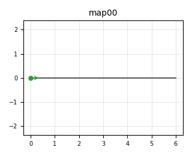
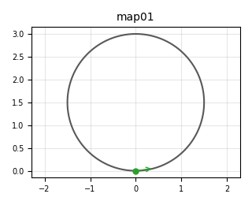
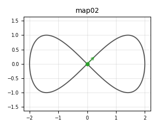
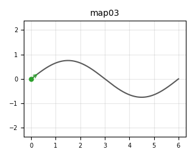
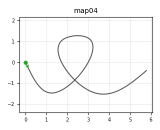
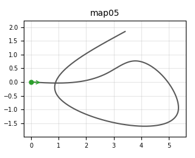
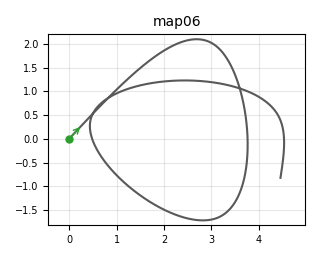
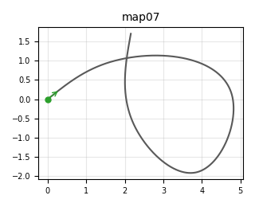

# Maps

Reference paths for the simulator. A map is **geometry only**; speed, noise,
latency and lag come from the scenario (`configs/scenarios/`), so any map can be
driven under any conditions:

```bash
python main.py --map map05 --controller pid                   # nominal conditions
python main.py --map map05 --scenario noisy --controller pid
```

| Folder | Content |
|---|---|
| `yaml/mapNN.yaml` | description, the exact command that generated it, length, max curvature |
| `csv/mapNN.csv` | the path every 1 cm: `s, x, y, yaw, kappa` (metres, radians) |
| `png/mapNN.png` | preview (green dot and arrow: start and direction) |

## Generating a map

```bash
python maps/generate.py --shape circle --radius 2         # basic shape
python maps/generate.py --random --points 6 --seed 9      # random spline
python maps/generate.py --catalogue                       # redraw png/ and the table below
```

Each command writes the next free number (`map08`, `map09`, …) into `yaml/` and
`csv/`, draws its preview, and refreshes the table below.

| Option | Meaning | Default |
|---|---|---|
| `--shape line \| circle \| eight \| s_curve` | basic shape, starts at the origin heading +x | |
| `--length`, `--radius`, `--laps`, `--width`, `--height`, `--amplitude`, `--periods` | shape size (m) | 6, 1.5, 1, 4, 2, 0.75, 1 |
| `--random` | cubic spline through random control points | |
| `--points` | number of control points | 6 |
| `--seed` | random seed (same seed, same map) | 0 |
| `--area W H` | region for control points (m) | 6 4 |
| `--min-spacing` | minimum distance between control points (m) | 1.0 |
| `--min-radius` | redraw until no turn is tighter than this (m) | 0.4 |
| `--name`, `--description` | custom name or description | next `mapNN`, auto |

If a random map is too wild or too tight, try another `--seed`, fewer `--points`
or a larger `--min-radius`. Run `python maps/generate.py --help` for everything.

**Published maps are benchmark fixtures.** Never edit or regenerate one; add a
new number instead, so results stay comparable over time. Any tool can make maps
as long as it writes the same CSV columns.

## Catalogue

<!-- maps:start -->
| Map | Preview | Length | Max κ |
|---|---|---|---|
| `map00` |  | 6.00 m | 0.00 1/m |
| `map01` |  | 9.43 m | 0.67 1/m |
| `map02` |  | 12.19 m | 2.40 1/m |
| `map03` |  | 6.84 m | 0.82 1/m |
| `map04` |  | 13.17 m | 2.39 1/m |
| `map05` |  | 15.13 m | 2.09 1/m |
| `map06` |  | 17.49 m | 1.83 1/m |
| `map07` |  | 12.45 m | 1.56 1/m |
<!-- maps:end -->
